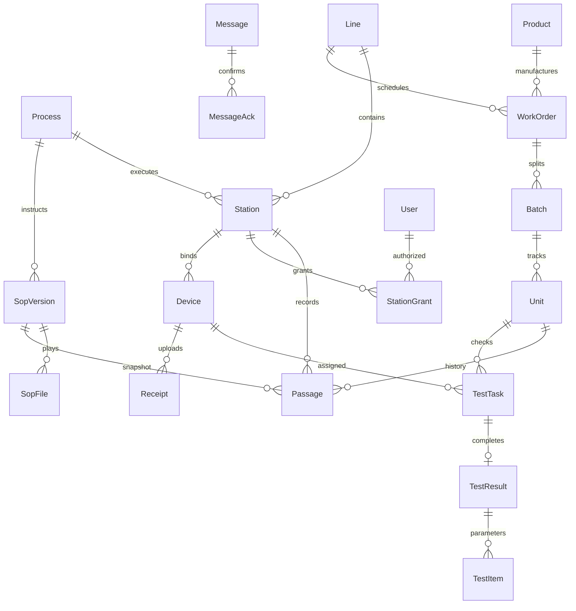

# 数据关系与 API 设计

所有主键使用 UUID，工序固定序号 1..5；业务唯一约束在数据库强制。时间存 UTC，界面显示 Asia/Shanghai。

另外存储 Session（哈希会话令牌、过期与撤销）、ScanContext（用户/工位/批次/等待产品）、ScanRequest（请求号+内容摘要+响应）、BarcodeRule（版本）、Audit、ExportJob、BackupJob、Settings。历史关系 RESTRICT 删除，产品条码唯一，过站 Unit+Process 唯一，测试 Device+RecordId 唯一、TaskId 唯一。附件用随机服务器文件名、原名仅展示。

API 统一 JSON；错误 {code,message}；401 未认证，403 越权，409 状态/重复冲突，422 参数或业务校验。用户使用 Bearer 会话，设备使用 X-Device-Key。登录限速，服务端密码哈希。

| 模块 | 路径及职责 |
|---|---|
| 基础 | GET /api/health；POST /api/auth/login、logout；GET /api/auth/me |
| 管理 | /api/admin/users、roles、grants、lines、stations、products、orders、batches、rules、devices、settings、audit |
| 工位 | GET /api/station/options；POST /api/station/scan、reset、heartbeat；GET /api/station/summary |
| 仪器 | /api/instrument/v1/user、work-orders、check、results、heartbeat；只供通用协议，详情后补 |
| 适配 | GET /api/admin/protocols、receipts；厂家协议不可用状态显式展示 |
| SOP | /api/sop/versions、files、review、publish；GET /api/sop/current/{processId} |
| 消息 | /api/messages；POST /api/messages/{id}/ack |
| 追溯 | GET /api/trace、/api/tests |
| 报表 | POST /api/exports；GET /api/exports、/api/exports/{id}/download |
| TV | GET /api/tv；SignalR /hubs/mes，通知仅作为刷新信号，不包含业务数据 |
| 备份 | /api/backups；预检+确认恢复；后台定时保留策略 |

发布/扫码/设备上传同一事务提交后才发送实时通知。客户端重连后重新拉取快照，避免漏事件。开发与正式配置隔离，不提交密钥。
